# 06-pjt · ThRead

> SSAFY 16기 관통 프로젝트 6회차 – **관계형 DB 설계**
> 도서를 등록하고, 읽은 뒤의 감상을 쓰레드(게시글)로 나누는 Django 도서 커뮤니티

| 항목 | 내용 |
| --- | --- |
| 프로젝트 / 앱 | `mypjt` / `accounts`, `books` |
| 사용 기술 | Python 3.11, Django 5.2, Bootstrap 5.3, SQLite |
| 팀원 | A: accounts 담당 (`최주희`) · B: books 담당 ('피윤아') |

---

## 목차

1. [실행 방법](#1-실행-방법)
2. [프로젝트 구조](#2-프로젝트-구조)
3. [ERD (모델 관계)](#3-erd-모델-관계)
4. [URL 구성](#4-url-구성)
5. [주요 기능](#5-주요-기능)
6. [요구사항 구현 현황](#6-요구사항-구현-현황)
7. [실행 결과 캡처](#7-실행-결과-캡처)
8. [협업 방식 (NF601)](#8-협업-방식-nf601)
9. [학습 내용](#9-학습-내용)
10. [느낀 점](#10-느낀-점)

---

## 1. 실행 방법

```bash
# 1. 가상환경 생성 및 활성화
python -m venv venv
source venv/Scripts/activate     # Windows (Git Bash)
# source venv/bin/activate       # macOS / Linux

# 2. 패키지 설치
pip install -r requirements.txt

# 3. DB 생성
python manage.py migrate

# 4. 서버 실행
python manage.py runserver
```

- 도서 목록 페이지: `http://127.0.0.1:8000/books/`
- `requirements.txt`: Django 5.2.19, pillow (프로필 사진 `ImageField`용), asgiref, sqlparse, tzdata
- `.gitignore`로 `db.sqlite3`, `media/`, `__pycache__/`, `venv/` 등은 제출하지 않음

---

## 2. 프로젝트 구조

```
06-pjt/
├── mypjt/                 # 프로젝트 설정 (settings.py, urls.py)
├── accounts/              # 회원 앱 (A 담당)
│   ├── models.py          # User (AbstractUser 상속)
│   ├── forms.py           # CustomUserCreationForm, CustomUserChangeForm
│   ├── views.py           # login, logout, signup, profile, follow, people, update, delete, change_password
│   └── templates/accounts/
├── books/                 # 도서 앱 (B 담당)
│   ├── models.py          # Book, Thread
│   ├── forms.py           # BookForm, ThreadForm
│   ├── views.py           # index, create, detail, update, delete, thread_*
│   └── templates/books/   # _form.html (공용 폼 조각) 포함
├── templates/base.html    # 공통 레이아웃 + Navbar
├── static/css/style.css   # 공통 스타일 (진행 중)
├── requirements.txt
└── .gitignore
```

---

## 3. ERD (모델 관계)

```mermaid
erDiagram
    USER ||--o{ BOOK : "작성 (1:N)"
    USER ||--o{ THREAD : "작성 (1:N)"
    BOOK ||--o{ THREAD : "도서의 쓰레드 (1:N)"
    USER }o--o{ THREAD : "좋아요 like_users (M:N)"
    USER }o--o{ USER : "팔로우 followings (M:N)"

    USER {
        string username
        string email
        string last_name
        string first_name
        string gender "M / F / O"
        int age
        int weekly_reading_time "주간 평균 독서 시간"
        int yearly_reading_count "연간 독서량"
        image profile_image
    }
    BOOK {
        string title "max 100"
        text description
        float customer_review_rank "0 ~ 5"
        string author "max 50"
        fk user
    }
    THREAD {
        string title "max 100"
        text content
        date read_date
        datetime created_at "auto_now_add"
        datetime updated_at "auto_now"
        fk book
        fk user
    }
```

| 관계 | 구현 코드 | 역참조 이름 |
| --- | --- | --- |
| User 1 : N Book | `Book.user = ForeignKey(AUTH_USER_MODEL)` | `user.book_set` |
| User 1 : N Thread | `Thread.user = ForeignKey(AUTH_USER_MODEL)` | `user.thread_set` |
| Book 1 : N Thread | `Thread.book = ForeignKey(Book)` | `book.thread_set` |
| User M : N Thread (좋아요) | `Thread.like_users = ManyToManyField(AUTH_USER_MODEL, related_name='like_threads')` | `user.like_threads` |
| User M : N User (팔로우) | `User.followings = ManyToManyField('self', symmetrical=False, related_name='followers')` | `user.followers` |

- `Thread`는 `user`와 `like_users` 두 곳에서 User를 참조합니다. 그래서 역참조 이름이 겹치지 않도록 `like_users`에 `related_name='like_threads'`를 지정했습니다.
- 모든 FK는 `on_delete=CASCADE`입니다. 도서가 삭제되면 그 도서의 쓰레드도 함께 삭제됩니다.

---

## 4. URL 구성

URL은 모두 `app_name` + `name`으로 참조합니다 (``). URL 문자열이 바뀌어도 템플릿과 view를 고칠 필요가 없습니다. (NF602)

### books (`/books/`)

| URL | name | view | 허용 Method |
| --- | --- | --- | --- |
| `/books/` | `books:index` | index | GET |
| `/books/create/` | `books:create` | create | GET, POST |
| `/books/<book_pk>/` | `books:detail` | detail | GET |
| `/books/<book_pk>/update/` | `books:update` | update | GET, POST |
| `/books/<book_pk>/delete/` | `books:delete` | delete | POST |
| `/books/<book_pk>/threads/create/` | `books:thread_create` | thread_create | GET, POST |
| `/books/threads/<thread_pk>/` | `books:thread_detail` | thread_detail | GET |
| `/books/threads/<thread_pk>/update/` | `books:thread_update` | thread_update | GET, POST |
| `/books/threads/<thread_pk>/delete/` | `books:thread_delete` | thread_delete | POST |
| `/books/threads/<thread_pk>/like/` | `books:like` | like | POST · 🚧 진행 중 |

### accounts (`/accounts/`)

| URL | name | view | 허용 Method |
| --- | --- | --- | --- |
| `/accounts/login/` | `accounts:login` | login | GET, POST |
| `/accounts/logout/` | `accounts:logout` | logout | POST |
| `/accounts/signup/` | `accounts:signup` | signup | GET, POST |
| `/accounts/profile/<username>/` | `accounts:profile` | profile | GET |
| `/accounts/<user_pk>/follow/` | `accounts:follow` | follow | POST |
| `/accounts/people/` | `accounts:people` | people (추가 기능) | GET |
| `/accounts/update/` | `accounts:update` | update | GET, POST |
| `/accounts/delete/` | `accounts:delete` | delete | POST |
| `/accounts/password/` | `accounts:change_password` | change_password | GET, POST |

---

## 5. 주요 기능

### 5-1. 공통

- **Navbar** (`templates/base.html`): 모든 페이지가 `base.html`을 상속하므로 Navbar가 모든 페이지에 같게 출력됩니다.
  - 항상 보임: 로고(ThRead), INDEX, PEOPLE
  - 로그인 전: LOGIN, SIGNUP
  - 로그인 후: CREATE, MY PROFILE, LOGOUT (POST form 버튼)
- **HTTP Method 제한** (NF603): 모든 view에 `@require_safe`, `@require_POST`, `@require_http_methods(['GET', 'POST'])`를 붙였습니다. 허용하지 않은 Method로 요청하면 `405 Method Not Allowed`를 돌려줍니다.
- **로그인 필요 기능**: `@login_required`를 붙였습니다. 로그인하지 않은 사용자는 `/accounts/login/?next=...`로 이동합니다.

### 5-2. books 앱 (B)

**도서 (Book)**

- **목록 (index)**: 모든 도서를 최신순(`-pk`)으로 보여 줍니다. 제목, 저자, 평점을 출력하고, 항목을 누르면 상세 페이지로 이동합니다. 로그인한 경우에만 "도서 작성" 버튼이 보입니다.
- **작성 (create)**: `BookForm`으로 입력을 받습니다. `form.save(commit=False)`로 먼저 객체를 만들고, `book.user = request.user`로 작성자를 넣은 뒤 저장합니다. 저장 후 상세 페이지로 redirect 합니다.
- **상세 (detail)**: 제목, 설명, 회원 리뷰 평점, 저자, 작성자를 출력합니다. 그 아래에 이 도서의 쓰레드 목록(`book.thread_set`)과 "쓰레드 작성" 버튼을 보여 줍니다.
- **수정 (update)**: 기존 데이터를 `instance=book`으로 미리 채웁니다. 작성자가 아니면 수정하지 않고 상세 페이지로 돌려보냅니다.
- **삭제 (delete)**: POST 요청만 받습니다. 작성자만 삭제할 수 있고, 삭제 후 목록 페이지로 이동합니다.
- **평점 검증**: `customer_review_rank`는 `FloatField` + `MinValueValidator(0)`, `MaxValueValidator(5)`입니다. 0~5 밖의 값은 저장되지 않고 에러 메시지가 폼에 표시됩니다.

**쓰레드 (Thread)**

- **작성 (thread_create)**: URL의 `book_pk`로 도서를 찾고, `thread.book`과 `thread.user`를 view에서 넣은 뒤 저장합니다. 저장 후 쓰레드 상세 페이지로 이동합니다.
- **상세 (thread_detail)**: 제목, 본문, 독서일, 도서 제목, 작성자, 좋아요 수를 출력합니다. "도서로 돌아가기" 링크가 있습니다.
- **수정 (thread_update) / 삭제 (thread_delete)**: 작성자만 수정 링크와 삭제 버튼을 볼 수 있고, view에서도 작성자를 한 번 더 확인합니다. 삭제 후에는 그 쓰레드가 속한 도서의 상세 페이지로 이동합니다.
- **폼**: `ThreadForm`은 `title`, `content`, `read_date`만 입력받습니다. `book`, `user`는 사용자가 고칠 수 없게 view에서 넣습니다. 독서일은 `type="date"` 달력 입력입니다.
- **공용 폼 템플릿**: 도서/쓰레드의 작성·수정 페이지 4개가 `books/_form.html`을 `include`로 함께 씁니다. 필드마다 label, 입력칸, 에러 메시지를 출력합니다.

### 5-3. accounts 앱 (A)

- **User 모델**: `AbstractUser`를 상속하고 성별, 나이, 주간 평균 독서 시간, 연간 독서량, 프로필 사진(`ImageField`), 팔로우(`followings`)를 추가했습니다. `settings.AUTH_USER_MODEL = 'accounts.User'`
- **회원가입 (signup)**: `UserCreationForm`을 상속한 `CustomUserCreationForm`을 씁니다. 프로필 사진 업로드를 위해 `request.FILES`와 `enctype="multipart/form-data"`를 사용합니다. 가입 후 바로 로그인합니다.
- **로그인 / 로그아웃**: `AuthenticationForm`, `auth_login`, `auth_logout`을 사용합니다. 로그아웃은 POST만 받습니다.
- **프로필 (profile)**: 누구나 볼 수 있습니다. 회원 정보, 팔로워 수, 팔로잉 수를 보여 줍니다. 내 프로필이면 "회원정보 수정 / 회원탈퇴", 다른 사람 프로필이면 "팔로우 / 언팔로우" 버튼이 보입니다.
- **팔로우 (follow)**: POST만 받습니다. 이미 팔로우했으면 취소하고, 아니면 팔로우합니다. 자기 자신은 팔로우할 수 없습니다.
- **회원정보 수정 (update)**: `UserChangeForm`을 상속하고 `password = None`으로 비밀번호 안내 영역을 감췄습니다. `is_staff` 같은 관리용 필드는 출력하지 않습니다.
- **비밀번호 변경 (change_password)**: `PasswordChangeForm`을 사용합니다. 변경 후 `update_session_auth_hash`로 세션을 갱신하여 로그아웃되지 않습니다.
- **회원탈퇴 (delete)**: POST만 받습니다. 탈퇴 후 로그아웃 처리합니다.
- **추가 기능 – PEOPLE 페이지**: 전체 사용자를 팔로워 수 순서로 보여 줍니다 (`annotate(Count('followers'))`). 로그인한 경우, 아직 팔로우하지 않은 사용자 5명을 "추천 친구"로 보여 줍니다.

---

## 6. 요구사항 구현 현황

> ✅ 완료 · 🚧 진행 중 · ⚠️ 동작하지만 명세와 다른 부분이 있음

| 번호 | 요구사항 | 담당 | 상태 | 비고 |
| --- | --- | --- | --- | --- |
| F601 | 프로젝트 구성 | 공통 | ✅ | `mypjt`, `accounts`, `books` |
| F602 | User Model | A | ✅ | |
| F603 | User Form | A | ✅ | |
| F604 | Book Model | B | ✅ | |
| F605 | Thread Model | B | ✅ | `like_users` M:N 포함 |
| F606 | Book / Thread Form | B | ✅ | ModelForm |
| F607 | login | A | ⚠️ | 로그인 후 **프로필**로 이동 (명세: 메인 페이지) |
| F608 | logout | A | ⚠️ | 로그아웃 후 **로그인 페이지**로 이동 (명세: 메인 페이지) |
| F609 | signup | A | ⚠️ | 가입 후 **프로필**로 이동 (명세: 메인 페이지) |
| F610 | profile | A | 🚧 | "작성한 쓰레드" 목록이 아직 주석 상태 |
| F611 | follow | A | ✅ | |
| F612 | update | A | ⚠️ | 수정 후 **프로필**로 이동 (명세: 메인 페이지) |
| F613 | delete | A | ⚠️ | 탈퇴 후 **로그인 페이지**로 이동 (명세: 메인 페이지) |
| F614 | change_password | A | ⚠️ | 변경 후 **프로필**로 이동 (명세: 메인 페이지) |
| F615 | index | B | ✅ | |
| F616 | create | B | ✅ | |
| F617 | detail | B | ✅ | |
| F618 | update | B | ✅ | |
| F619 | delete | B | ✅ | |
| F620 | thread_create | B | ✅ | |
| F621 | thread_detail | B | 🚧 | 좋아요 **수**는 출력, 좋아요 **버튼**은 F624 완료 후 연결 |
| F622 | thread_update | B | ✅ | |
| F623 | thread_delete | B | ✅ | |
| F624 | like | A | 🚧 | view, URL 작업 중 |
| NF601 | Git 활용 | 공통 | ✅ | [8장](#8-협업-방식-nf601) 참고 |
| NF602 | URL 구성 | 공통 | ✅ | `app_name` + URL name |
| NF603 | HTTP Method 허용 | 공통 | ✅ | 데코레이터로 제한 |
| - | CSS 프론트엔드 | 공통 | 🚧 | Bootstrap 적용 완료, `style.css` 작업 중 |
| F625~F628 | 심화 (AI 활용) | - | - | 이번 프로젝트에서는 구현하지 않음 |

### 남은 작업 (TODO)

- [ ] F624 `like` view 작성 → `books/urls.py`의 like path 주석 해제
- [ ] `thread_detail.html`의 좋아요 버튼 `` 해제 (F621)
- [ ] `profile.html`의 "작성한 쓰레드" 목록 주석 해제 (F610)
- [ ] `mypjt/urls.py`에 `''` → `books:index` redirect 추가 (현재 `/`는 404)
- [ ] accounts view의 redirect 대상을 메인 페이지(`books:index`)로 맞추기 (F607~F609, F612~F614)
- [ ] `static/css/style.css` 스타일 작업
- [ ] (선택) `accounts/admin.py`, `books/admin.py`에 모델 등록
- [ ] 두 계정으로 전체 흐름 최종 테스트 후 이 표 갱신

---

## 7. 실행 결과 캡처

> 이미지는 `images/` 폴더에 넣고 아래 경로를 맞춰 주세요.

### 공통
| 화면 | 캡처 |
| --- | --- |
| Navbar – 로그인 전 |  |
| Navbar – 로그인 후 |  |

### accounts
| 번호 | 화면 | 캡처 |
| --- | --- | --- |
| F607 | 로그인 |  |
| F608 | 로그아웃 후 화면 |  |
| F609 | 회원가입 |  |
| F610 | 프로필 (내 프로필 / 다른 사람 프로필) |  |
| F611 | 팔로우 / 언팔로우 |  |
| F612 | 회원정보 수정 |  |
| F613 | 회원탈퇴 | 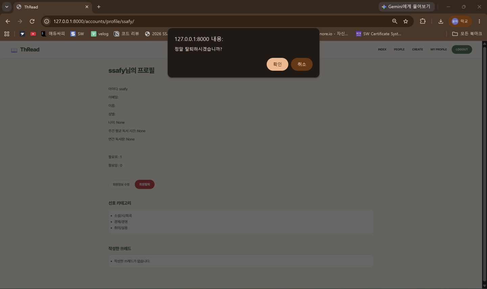 |
| F614 | 비밀번호 변경 | 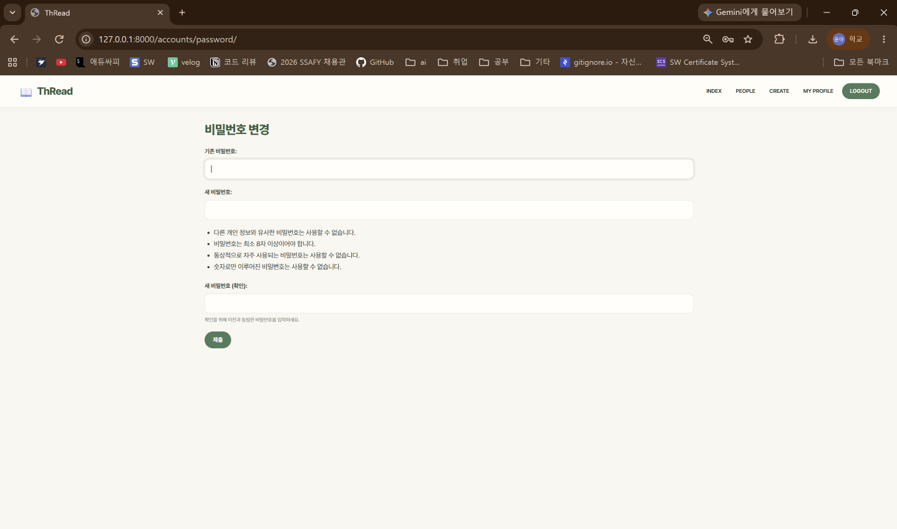 |
| 추가 | PEOPLE (추천 친구) |  |

### books
| 번호 | 화면 | 캡처 |
| --- | --- | --- |
| F615 | 도서 목록 | 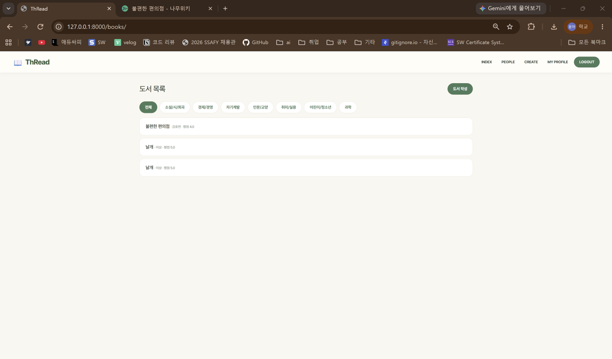 |
| F616 | 도서 작성 |  |
| F616 | 도서 작성 – 평점 6 입력 시 에러 메시지 | 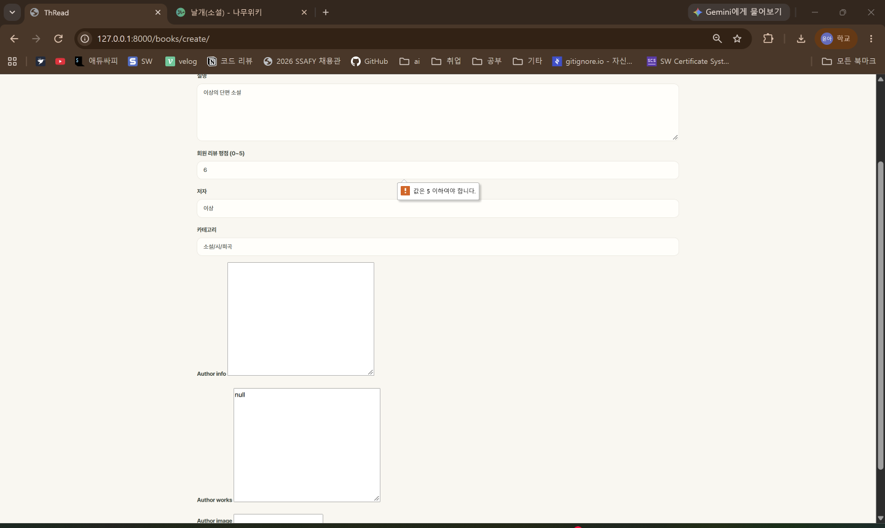 |
| F617 | 도서 상세 (작성자 / 다른 사용자) |  |
| F618 | 도서 수정 (기존 값 채워짐) | 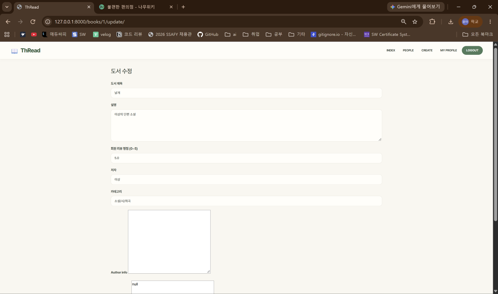 |
| F619 | 도서 삭제 후 목록 | 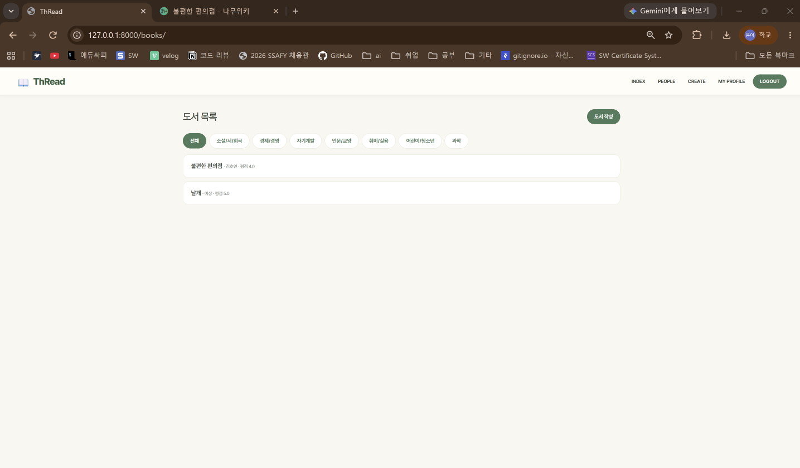 |
| F620 | 쓰레드 작성 |  |
| F621 | 쓰레드 상세 | 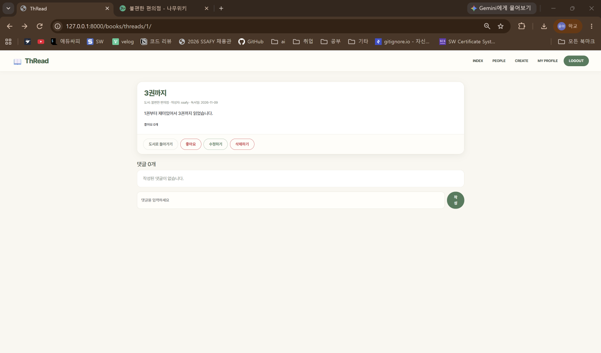 |
| F622 | 쓰레드 수정 | 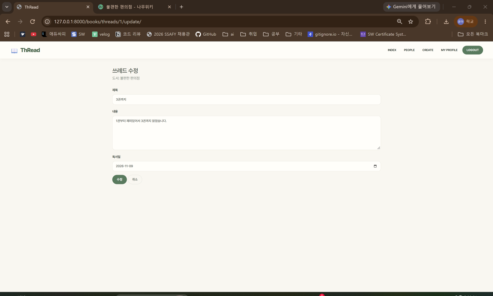 |
| F623 | 쓰레드 삭제 후 도서 상세 | 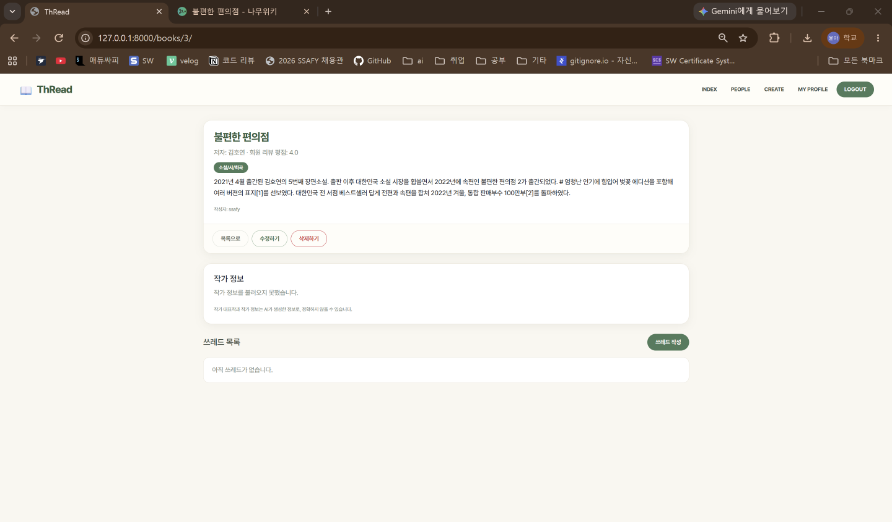 |
| F624 | 좋아요 / 좋아요 취소 | 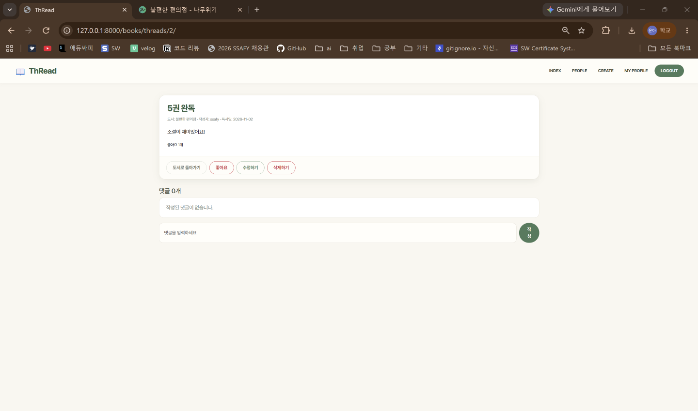 |
| NF603 | GET으로 삭제 URL 접근 시 405 | 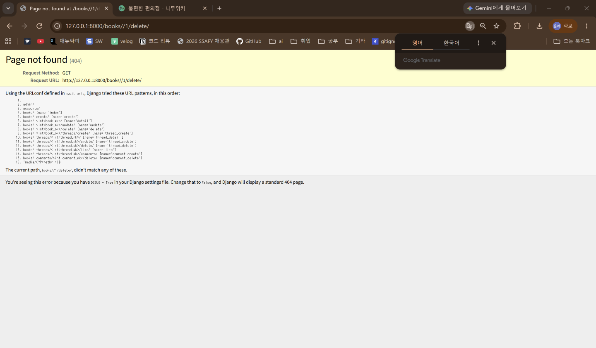 |

---

## 8. 협업 방식 (NF601)

### 8-1. 역할 분담

| 담당 | 앱 | 요구사항 |
| --- | --- | --- |
| A | accounts | F601~F603, F607~F614, F624 (like) |
| B (윙스) | books | F604~F606, F615~F623 |

- 작업 전에 **필드명과 URL name을 먼저 합의**했습니다. 그래서 상대의 코드가 아직 없어도 각자 작업할 수 있었습니다.
  - Book: `title`, `description`, `customer_review_rank`, `author`, `user`
  - Thread: `title`, `content`, `read_date`, `created_at`, `updated_at`, `book`, `user`, `like_users (related_name='like_threads')`
  - 메인 페이지: `books:index`
- 코드 스타일도 맞췄습니다. view에서 객체를 조회할 때 두 사람 모두 `Model.objects.get(pk=...)`를 사용합니다.

### 8-2. Branch 원칙

GitHub Flow를 참고하여 단순하게 운영했습니다.

| Branch | 용도 | 사용 방법 |
| --- | --- | --- |
| `master` | 제출용 기본 브랜치. 항상 실행되는 코드만 둠 | 직접 commit하지 않음. Merge Request(MR)로만 합침 |
| `book` | B의 books 앱 작업 | `master`에서 분기 → 작업·commit → push → MR → `master`에 merge |
| `A 브랜치 이름 입력` | A의 accounts 앱 작업 | `master`에서 분기 → 작업·commit → push → MR → `master`에 merge |

**작업 흐름**

```bash
# 1. 최신 master 받기
git switch master
git pull origin master

# 2. 내 브랜치로 이동 (처음이면 -c 로 생성)
git switch book            # 또는: git switch -c book

# 3. 최신 master 내용을 내 브랜치에 반영
git merge master

# 4. 작업 후 commit
git add .
git commit -m "feat: 도서 상세 페이지 구현"

# 5. push 후 GitLab에서 Merge Request 생성
git push -u origin book
```

**Merge 순서 합의**

공유 파일(`base.html`, `urls.py`)이 있어서 순서를 정했습니다.

1. A: 프로젝트 뼈대 + accounts → `master`
2. B: books → `master`
3. A: profile 쓰레드 목록 + like → `master`
4. B: 좋아요 버튼 연결 → `master`

### 8-3. Commit 메시지 원칙

**형식**: `타입: 무엇을 했는지 (한국어, 한 줄)`

| 타입 | 의미 | 예시 |
| --- | --- | --- |
| `feat` | 새 기능 | `feat: Thread 모델 생성` |
| `fix` | 버그 수정 | `fix: 쓰레드 삭제 후 redirect 경로 수정` |
| `style` | CSS, 화면 꾸미기 (기능 변화 없음) | `style: navbar 색상 변경` |
| `refactor` | 동작은 같고 코드 구조만 바꿈 | `refactor: 작성/수정 폼을 _form.html로 분리` |
| `docs` | README 등 문서 | `docs: README 협업 원칙 작성` |
| `chore` | 설정, 패키지, .gitignore | `chore: requirements.txt 추가` |

**Commit 시점**

- 기능 1개가 **실제로 동작하는 것을 확인한 뒤** commit 합니다. (예: model + migration 1번, view + template 1번)
- 서버가 실행되지 않는 상태로는 commit 하지 않습니다.
- push 전에 `git status`로 `db.sqlite3`, `__pycache__`, `venv`가 포함되지 않았는지 확인합니다.

> ✏️ 위 원칙은 팀에서 실제로 합의한 내용과 다르면 수정해 주세요.

### 8-4. 문제 상황과 원인 분석

**① `base.html` merge conflict**

- **상황**: `book` → `master` MR에서 `templates/base.html`에 conflict가 발생했습니다.
- **원인**: A와 B가 같은 파일의 **같은 줄(Navbar 링크)**을 각자 수정했습니다. A는 accounts 링크를 넣었고, B는 INDEX, CREATE, 로고 링크를 `books:index`, `books:create`로 바꿨습니다. Git은 두 변경 중 어느 것을 남길지 스스로 정할 수 없습니다.
- **해결**: B가 conflict 부분을 직접 확인했습니다. 두 사람의 링크를 모두 남기도록 합친 뒤 commit 하고 merge 했습니다.
- **배운 점**: 여러 사람이 고치는 공유 파일(`base.html`, `mypjt/urls.py`, `settings.py`)은 **한 사람이 담당**하거나, 수정 전에 서로 알리는 것이 좋습니다.

**② 상대 코드가 없을 때 `NoReverseMatch` 에러**

- **상황**: books만 있을 때 모든 페이지에서 `NoReverseMatch` 에러가 났습니다.
- **원인**: `base.html`이 `accounts:login` 같은 URL name을 쓰는데, 그때는 `accounts/urls.py`가 비어 있었습니다.
- **해결**: 로컬에서만 임시 accounts URL을 만들어 테스트했고, 그 파일은 commit 하지 않았습니다. A의 accounts가 merge된 뒤 정상 동작을 확인했습니다.
- **배운 점**: URL name을 미리 합의해도, 실제 코드가 들어오는 **merge 순서**가 중요합니다.

> ✏️ 추가로 생긴 문제가 있으면 같은 형식(상황 / 원인 / 해결 / 배운 점)으로 적어 주세요.

### 8-5. 원칙 점검 (프로젝트 종료 시)

| 원칙 | 지켜졌는가 | 근거 / 반성 |
| --- | --- | --- |
| `master`에 직접 commit 하지 않기 | ⬜ 확인 필요 | 초기 프로젝트 뼈대 commit 확인 필요 |
| 기능별 브랜치에서 작업 후 MR로 merge | ✅ | `book` → `master` MR로 merge |
| merge 전 `master` 최신 내용 반영 | ⬜ 확인 필요 | `base.html` conflict는 MR 단계에서 발견됨 |
| commit 메시지 `타입: 내용` 형식 | ⬜ 확인 필요 | 아래 스크린샷 기준으로 점검 |
| 동작 확인 후 commit | ⬜ 확인 필요 | |
| 불필요한 파일 제출하지 않기 | ✅ | `.gitignore` 적용 (`db.sqlite3`, `media/`, `__pycache__/`) |
| 합의한 필드명 / URL name 지키기 | ✅ | 두 앱 코드가 수정 없이 연결됨 |

### 8-6. GitLab Commit 기록

> GitLab → Code → Commits / Repository → Graph 화면을 캡처해서 넣어 주세요.

**전체 commit 목록**


**브랜치 그래프**


**Merge Request (`book` → `master`)**


---

## 9. 학습 내용

### 9-1. N:1 관계 (ForeignKey)

- `Thread.book = ForeignKey(Book, on_delete=CASCADE)`로 "쓰레드 N개 : 도서 1개"를 만듭니다.
- DB에는 `book_id` 컬럼이 생깁니다.
- 정참조: `thread.book.title` / 역참조: `book.thread_set.all()`
- 작성자, 도서처럼 **사용자가 입력하면 안 되는 FK**는 폼에서 빼고 view에서 넣습니다.

```python
thread = form.save(commit=False)   # DB 저장 전 객체만 생성
thread.book = book                 # URL로 받은 도서
thread.user = request.user         # 로그인한 사용자
thread.save()
```

### 9-2. M:N 관계 (ManyToManyField)

- 좋아요와 팔로우는 "여러 사용자 : 여러 대상" 관계입니다. Django가 **중간 테이블**을 자동으로 만듭니다.
- 한 모델이 User를 두 번 참조하면 역참조 이름이 충돌합니다. 그래서 `related_name`으로 이름을 바꿉니다.
  - `user.thread_set` → 내가 **쓴** 쓰레드
  - `user.like_threads` → 내가 **좋아요한** 쓰레드
- 자기 자신과 M:N인 팔로우는 `symmetrical=False`가 필요합니다. 그래야 "내가 팔로우 = 상대도 나를 팔로우"가 되지 않습니다.
- `add()`, `remove()`, `filter(...).exists()`로 토글 기능을 만듭니다.

### 9-3. ModelForm과 유효성 검증

- `exclude` / `fields`로 사용자에게 보여 줄 필드를 정합니다.
- 모델의 `validators`(평점 0~5)가 `form.is_valid()`에서 자동으로 검사됩니다.
- `instance=`를 넘기면 수정 폼에 기존 값이 채워지고, `save()`가 UPDATE로 동작합니다.
- 작성 / 수정 화면이 같은 폼이라서 `_form.html`로 분리하고 `include`로 재사용했습니다.

### 9-4. Django 인증 시스템

- `AbstractUser`를 상속하면 기본 인증 기능은 그대로 쓰고 필드만 추가할 수 있습니다. `AUTH_USER_MODEL`은 **첫 migrate 전에** 설정해야 합니다.
- 다른 앱에서 User를 참조할 때는 `settings.AUTH_USER_MODEL`, view에서는 `get_user_model()`을 씁니다.
- 비밀번호 변경 후에는 세션 해시가 바뀌므로 `update_session_auth_hash`가 필요합니다.

### 9-5. 권한과 HTTP Method

- 템플릿에서 버튼을 숨기는 것만으로는 부족합니다. URL을 직접 입력할 수 있으므로 **view에서도 작성자를 확인**해야 합니다.
- 데이터를 바꾸는 요청(삭제, 로그아웃, 팔로우, 좋아요)은 `@require_POST` + CSRF 토큰으로 보호합니다.
- 데코레이터 순서: `@login_required`를 위에 둡니다. 로그인 확인을 먼저 합니다.

### 9-6. Git 협업

- 브랜치를 나누면 동시에 작업할 수 있지만, **공유 파일**에서는 conflict가 생깁니다.
- conflict는 에러가 아니고, Git이 사람에게 선택을 요청하는 것입니다. `<<<<<<<`, `=======`, `>>>>>>>` 사이를 읽고 남길 코드를 정합니다.

---

## 10. 느낀 점

** A (최주희 · accounts) **

- 회원 기능을 맡으면서 Django가 이미 많은 것을 만들어 두었다는 것을 느꼈다. AbstractUser와 기본 Form을 상속하니, 나는 필요한 필드와 화면에만 집중할 수 있었다.
- 비밀번호를 바꾸면 로그아웃되고, 프로필 사진이 저장되지 않는 문제를 하나씩 찾아가는 과정이 가장 기억에 남는다. 덕분에 세션과 파일 업로드의 동작을 이해했다.
- 팔로우를 만들며 User가 User를 참조하는 관계가 신기했다. PEOPLE 페이지와 추천 친구까지 만들면서, 배운 ORM을 내 아이디어에 써 보는 재미를 느꼈다.
- books 코드가 없을 때 연결 부분을 TODO로 남기고 기다렸다. 협업에서는 내 코드가 팀원 코드와 어디서 만나는지 계속 생각해야 한다는 것을 배웠다.


** B (피윤아 · books) **

- 비슷한 CRUD 기능을 9개 반복해 만드니, 처음엔 헷갈리던 흐름(GET이면 화면, POST면 저장)이 자연스럽게 손에 익었다.
- 작성자 확인 코드를 쓰면서 "버튼을 숨기는 것"과 "실제로 막는 것"은 다르다는 것을 깨달았다.
- 작성·수정 화면을 _form.html 하나로 합치면서, 중복을 줄이면 나중에 고칠 때 편하다는 것을 직접 느꼈다.
- base.html conflict를 처음 직접 해결했다. 둘이 같은 줄을 고친 것이 원인이었고, 코드 실력만큼 미리 정하고 소통하는 것이 중요하다는 것을 배웠다.
- 필드명과 URL 이름을 먼저 맞춘 덕분에, 상대 코드 없이도 내 부분을 끝까지 만들 수 있었다. 다음 프로젝트에서도 이 방식을 쓰고 싶다.